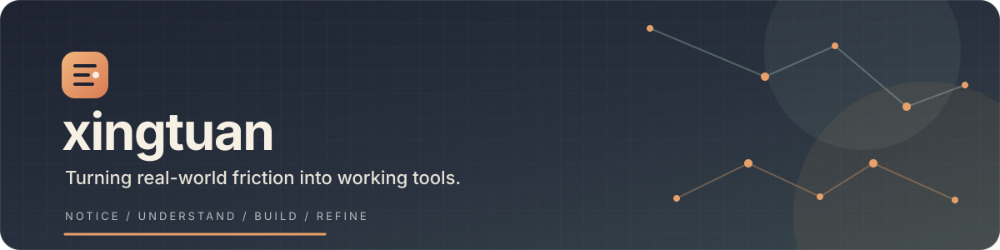

  

## About

I'm **xingtuan**. I build tools for the friction I keep running into: a workflow that's easy to get wrong, a setting buried too deep, a system quirk that has a fixable cause. I care less about which stack a problem belongs to and more about whether the result actually works.

Reach me at [new2738547293@gmail.com](mailto:new2738547293@gmail.com).

## Skills

  

**Java and Kotlin** are my strongest languages — fluent in both, and I write them daily. On **Android** I know the platform well: app structure, lifecycle, UI, and the build tooling around it. **Windows** is home ground for desktop work, from application development to system-level behavior. I also use **AI coding agents** in real work, scoping tasks, driving tools, and verifying the result instead of trusting the output.

Also in the toolbox: C#, TypeScript, JavaScript, Python; IntelliJ IDEA, VS Code, Git; Photoshop and Premiere Pro for visual work.

## Contributions

  
  

  

- **[BetterPrint](https://github.com/xingtuan416/BetterPrint)** · TypeScript · Electron · React
- **[MusicboxMC](https://github.com/xingtuan416/MusicboxMC)** · TypeScript · Electron · MIDI
- **[HackintoshDisplayFix](https://github.com/xingtuan416/HackintoshDisplayFix)** · Shell · EDID

More on [my repositories](https://github.com/xingtuan416?tab=repositories).

---

  Curiosity opens the issue. Logs keep the evidence. Tests make the call.

